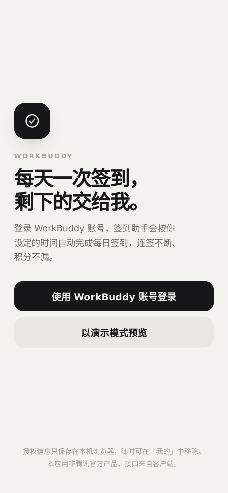
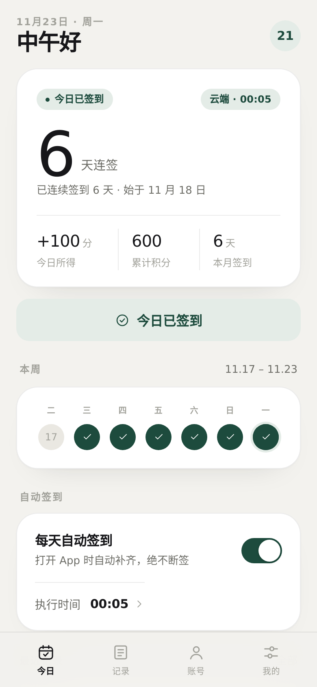
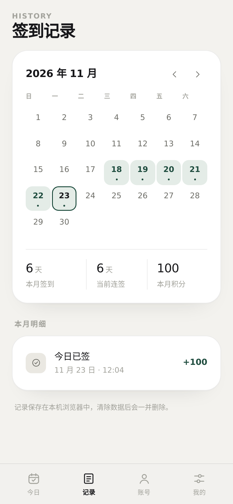
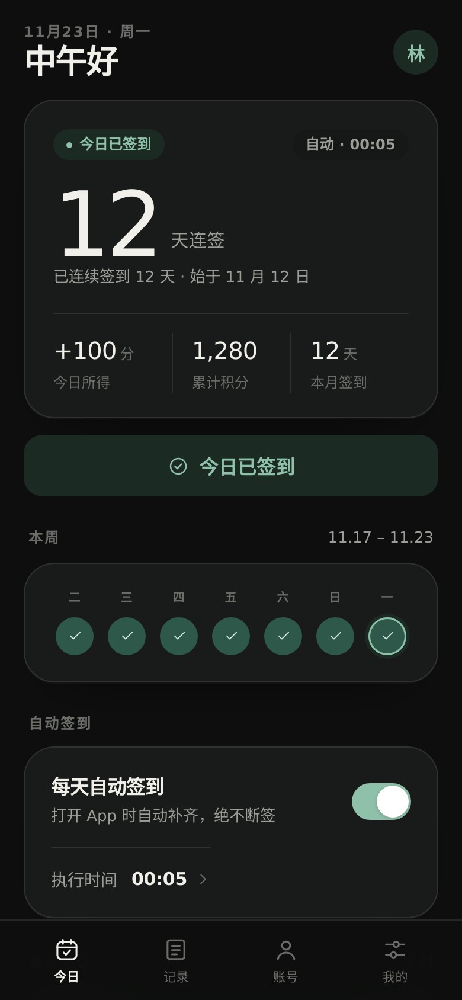
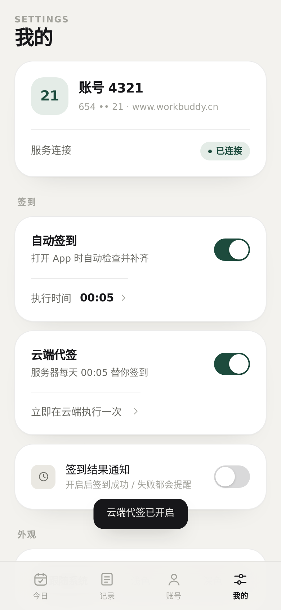
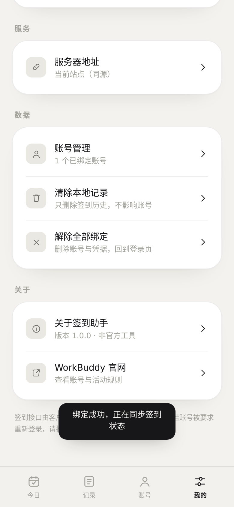

# 签到助手 · WorkBuddy

登录 WorkBuddy 账号，每天自动完成签到：既可以在手机上像原生 App 一样打开（PWA / APK），也可以把凭据交给自己的服务器做 7×24 云端代签，结果推到手机通知栏。

界面走 Apple 风格：暖白纸感背景、墨黑主色、松绿点缀、发丝分隔线、柔和大圆角。**不使用紫色、不使用任何渐变、不使用 Material 3 组件语言、不使用 emoji 图标**（图标全部是 24px 描边 SVG）。

| 登录 | 今日 | 记录 | 深色 |
|---|---|---|---|
|  |  |  |  |

| 云端代签 | 设置 |
|---|---|
|  |  |

## 功能

- **今天**：连签天数、今日可得 / 所得、累计积分、本月签到、本周七点条、一键签到。
- **自动签到**：打开 App 时自动补齐；可设每日执行时间（默认 00:05）。
- **云端代签**：把账号交给服务器，每天定时签到，手机不用打开。
- **通知**：签到成功 / 失败 / 授权失效推送系统通知（Web Push）。
- **记录**：月历（已签打点）+ 本月统计 + 逐条明细，云端记录会标「云端」。
- **账号**：多账号绑定、切换、更新授权、移除。
- **外观**：浅色 / 深色 / 跟随系统。
- **登录**：网页版官方页面登录 + 一次性粘贴；APK 内直接打开官方授权页并自动读取登录态。
- **交付形态**：网页 App、PWA（可加到主屏）、Android APK（Capacitor）。

## 快速开始

```bash
cd workbuddy-app
npm install        # 服务端依赖（web-push 等）
npm start          # http://127.0.0.1:5178
```

手机与电脑同一 Wi-Fi 时，用手机浏览器打开 `http://<电脑内网IP>:5178`，菜单里选「添加到主屏幕」。

先点「以演示模式预览」可以完整看一遍界面（数据是示意，不会真的签到）。

## 登录方式

WorkBuddy 没有公开的账号密码登录接口，官方登录走客户端 / 微信 / 手机号授权；网页又受同源策略限制，读不到官方页面里的登录态。所以流程是两步：

1. 在官方页面（或已登录的桌面客户端）完成登录；
2. 把客户端写在 `workbuddy-desktop.info` 里的 `accessToken`（或整段 JSON）粘贴进来，自动识别 UID 并绑定。

**APK 里是 App 内登录**：点「使用 WorkBuddy 账号登录」会在 App 内打开官方授权页，用微信 / QQ 登录后点「已完成」，原生 WebView 会把登录态读回来并自动绑定，不需要手动复制。自动识别失败时（官方页面改了存储方式），仍可回退到粘贴。

绑定只需一次。失效（接口返回 401）时 App 会提示重新绑定。

凭据默认只存在浏览器 localStorage，不上传任何第三方服务器；只有你主动开启「云端代签」那个账号，才会把凭据发到你自己的服务器，并用 AES-256-GCM 加密落盘。

## 云端代签（7×24）

在「我的 → 云端代签」打开即可。服务端行为：

- 凭据用 `AES-256-GCM` 加密后写入 `data/accounts.json`（文件 0600、目录 0700）；
- 密钥来自环境变量 `WB_SECRET`；未设置时自动在 `data/secret.key` 生成一份；
- 每 30 秒检查一次，到点在服务端完成「查状态 → 未签才领」，幂等；
- 结果写入 `data/accounts.json` 并可通过 Web Push 推送；
- 授权失效时标记 `needsRebind`，推送提醒，不反复重试；网络错误则 10 分钟后重试。

部署到公网时至少要做两件事：

```bash
WB_SECRET='一段足够长的随机字符串' \
WB_ACCESS_KEY='给 App 用的访问口令' \
PORT=8080 node server.mjs
```

`WB_ACCESS_KEY` 设置后，签到代理与云端接口都要带 `X-Access-Key` 头；App 里在「我的 → 访问口令」填同一个值即可。

> 服务端保存的是完整账号令牌，等同账号密码。请只部署在自己的机器上，并做好磁盘与备份的访问控制。

## 部署

```bash
export WB_SECRET="$(openssl rand -base64 32)"   # 加密密钥，换掉等于作废旧凭据
export WB_ACCESS_KEY="<访问口令>"
docker compose up -d --build                     # 或者 docker build -t wb-checkin . && docker run
```

| 变量 | 说明 |
|---|---|
| `WB_SECRET` | 凭据加密密钥（必填，务必固定保存） |
| `WB_ACCESS_KEY` | 接口访问口令；为空则不鉴权，公网部署务必设置 |
| `PORT` / `HOST` | 监听端口与地址，默认 `5178` / `0.0.0.0` |
| `WB_DATA_DIR` | 数据目录，默认 `./data`，容器里是 `/app/data` |

Render 用户可以直接用仓库里的 `render.yaml`（需要持久磁盘，免费实例重启会丢数据）。HTTPS 可以用 Caddy 一行反代：

```
checkin.example.com {
    reverse_proxy 127.0.0.1:8080
}
```

推送必须 HTTPS。完整的真机验证步骤见 [docs/verification.md](docs/verification.md)。

## 通知

Web Push 需要 **HTTPS 或 localhost** 才可用（局域网 http 地址不行）。开启后：

- 第一次会请求通知权限，并用服务端 `/api/push/key` 的 VAPID 公钥订阅；
- 云端签到后推送标题 + 结果，例如「签到成功 · +100 · 连续 7 天」；
- 「我的 → 发送测试通知」可以立刻验证链路。

订阅失效（404 / 410）时服务端会自动清理。

## Android APK

工程已用 Capacitor 生成在 `android/`，两种构建方式：

**GitHub Actions（推荐）**：`.github/workflows/android.yml`，在 Actions 里手动触发 `Android APK`，产物在 `workbuddy-checkin-debug` 里。

**本机（x86_64 Linux / macOS）**：

```bash
bash scripts/build-apk.sh    # 会装 JDK 17 + Android SDK，然后 gradlew assembleDebug
```

> 这台手机是 arm64，Google 的 `aapt2` 等构建工具只有 x86_64 版本，本地无法编译 APK，所以本次交付走 CI 构建。

APK 内的页面来自本地打包资源，接口仍然要打到你的服务器：首次打开后在「我的 → 服务器地址」填 `https://你的域名`，其余与网页版一致。

## 设计规范

| Token | 值 | 用途 |
|---|---|---|
| `--paper` | `#f3f2ee` / `#0d0e0d` | 背景（暖白 / 近黑） |
| `--card` | `#ffffff` / `#191b1a` | 卡片 |
| `--ink` | `#17171a` / `#f0efe9` | 主文字、主按钮 |
| `--pine` | `#1d4b3d` / `#8fc0aa` | 唯一的强调色 |
| `--clay` | `#96683c` | 提醒用的暖色 |
| 圆角 | 26 / 16 / 12 | 卡片 / 按钮 / 输入框 |
| 动效 | `cubic-bezier(.32,.72,0,1)` | 统一缓动 |

无渐变、无紫色、无 Material 涟漪与悬浮按钮；阴影只做极轻的层次；数字统一 `tabular-nums`，大数字用 300 字重拉开对比。

## 技术结构

```
workbuddy-app/
├── server.mjs                # 静态托管 + 签到转发 + 云端接口
├── lib/
│   ├── crypto.mjs            # AES-256-GCM 封装
│   ├── store.mjs             # 加密账户仓库（原子写入）
│   ├── upstream.mjs          # 签到接口调用与归一化
│   ├── scheduler.mjs         # 定时任务（时区、重试、幂等）
│   └── push.mjs              # VAPID / Web Push
├── public/                   # App 前端（无框架）
│   ├── index.html
│   ├── css/app.css           # 设计系统
│   ├── js/app.js             # 视图与业务
│   ├── js/icons.js           # 描边图标
│   ├── sw.js                 # 离线外壳 + 推送
│   └── manifest.webmanifest
├── android/                  # Capacitor 生成的 Android 工程
├── .github/workflows/        # APK 构建
└── scripts/                  # 截图自检、APK 构建
```

接口：

| 用途 | 接口 |
|---|---|
| 查签到状态 | `POST /v2/billing/meter/checkin-activity-status` |
| 领取签到 | `POST /v2/billing/meter/daily-checkin` |

自有接口：`/api/wb`（转发）、`/api/cloud/{accounts,bind,update,unbind,run,results}`、`/api/push/{key,subscribe,test}`、`/api/health`。

## 限制与风险

- 签到接口由客户端行为整理而来，**不是官方公开 API**，可能随版本失效。
- 云端代签会把凭据交给服务器，安全责任在你自己的部署。
- 网页版无法后台常驻，自动签到只在 App 运行时生效；要 7×24 用云端代签。
- 网页版受同源策略限制，做不到内置登录；APK 里可以（原生 WebView 接管官方页面）。微信 OAuth 对内嵌浏览器较敏感，若卡在授权页请改用 QQ 登录或手动粘贴。

## 免责声明

本项目不是腾讯官方产品，与 WorkBuddy 无隶属关系。请遵守 WorkBuddy 服务条款，使用风险自负。
